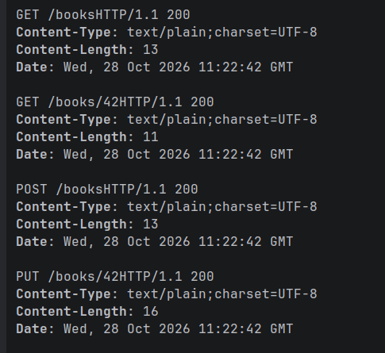

# Registro de aprendizaje del grupo

## Entrega 1

### Respuestas a las preguntas de comprensión

1. **Verbo HTTP y anotación.** `@GetMapping` atiende `GET`, `@PostMapping`
   atiende `POST`, `@PutMapping` atiende `PUT` y `@DeleteMapping` atiende
   `DELETE`. Cada método del controlador queda asociado a un verbo concreto, de
   modo que `GET /books` y `POST /books` son operaciones distintas aunque
   compartan la misma ruta.

2. **Ruta final de cada endpoint.** La ruta se compone de la anotación de clase
   más la del método. `@RequestMapping("/books")` en la clase y `@GetMapping`
   vacío en el método dan `/books`. `@GetMapping("/{id}")` añade el segmento
   variable y da `/books/{id}`. El segmento `{id}` debe coincidir con el nombre
   declarado en `@PathVariable`.

3. **`@PathVariable("id") Long id`.** Toma el valor del segmento `{id}` de la
   URL y lo inyecta como argumento. Spring convierte el texto de la URI al tipo
   declarado: `/books/42` llega como `"42"` y se convierte a `Long` mediante su
   servicio de conversión. Es `Long` porque el identificador es numérico y así
   podemos compararlo, ordenarlo o generar el siguiente sin conversiones
   manuales. Si la URL trae algo no convertible, por ejemplo `/books/abc`,
   Spring responde `400` antes de entrar al método. No hay que confundirlo con
   `@RequestParam`, que lee parámetros de query (`/books?id=42`), ni con
   `@RequestBody`, que lee el cuerpo de la petición.

4. **`produces = MediaType.TEXT_PLAIN_VALUE`.** Declara que este controlador
   solo produce `text/plain` por eso la respuesta lleva
   `Content-Type: text/plain charset=UTF-8`. Además de documentar el contrato,
   restringe la negociación de contenido, ya que si el cliente pide un tipo que no
   encaja, la petición puede rechazarse con `406 Not Acceptable`. Al devolver
   `String` con `@RestController`, el cuerpo se escribe tal cual mediante el
   conversor de cadenas, sin serialización JSON.

5. **`@RestController`.** Es una especialización de `@Controller` que añade
   `@ResponseBody` a todos los métodos. Eso significa que el valor devuelto se
   escribe en el cuerpo de la respuesta a través de los `HttpMessageConverter`,
   en lugar de interpretarse como el nombre de una vista. Por eso
   `return "GET /books"` produce literalmente el texto `GET /books`: no es una
   vista llamada así ni una redirección. Si la clase fuese solo `@Controller`
   sin `@ResponseBody`, Spring intentaría resolver `"GET /books"` como nombre de
   vista y la petición fallaría.

6. **Qué no existe todavía en el proyecto.** No hay modelo `Book` ni DTOs, no
   hay capa de servicio ni repositorio, no hay colección en memoria ni
   generación de identificadores, no hay validación con Bean Validation ni
   `@Valid`, no hay excepciones propias ni manejador de errores, y no se usa
   `ResponseEntity`, así que no hay control de códigos ni cabeceras. Tampoco hay
   persistencia, seguridad ni migraciones. Las consecuencias visibles son:
   `POST /books` no crea nada y devuelve texto, `GET /books` no lista libros,
   `DELETE /books/42` responde `200` aunque el recurso no exista y nunca se
   devuelve `404`. 



## Entrega 2

- **Comportamiento que añadimos o contrato que evolucionamos.** La API pasa de
  mostrar texto a hacer operaciones CRUD en JSON en memoria sobre `/books`. Se
  elimina `produces = text/plain` de la clase. Se introducen `BookRequestDTO` y
  `BookResponseDTO`, el modelo interno `Book` en `model` y una colección
  `Map<Long, Book>` con `LinkedHashMap` (mantiene el orden de inserción) más un
  `AtomicLong` para generar ids. Los cinco endpoints devuelven DTOs: `GET
  /books` devuelve un array JSON, `GET /books/{id}` devuelve el libro, `POST
  /books` devuelve el libro creado con su id, `PUT /books/{id}` devuelve el
  libro actualizado y `DELETE /books/{id}` devuelve un `200` sin cuerpo. En esta
  etapa el alta sigue devolviendo `200`, tal como establece el contrato el
  `201` con `Location` y el `204` son de la entrega 3.

- **Test y rojo observado.** Activamos la semilla de la entrega 2 con
  `java classroom/ActivarEntrega.java 2` y la dejamos en rojo antes de tocar el
  código, en el commit `Entrega 2: activa tests en rojo`. Eran fallos de
  comportamiento, no de compilación: `startsWithEmptyJsonList` ya pasaba porque
  el controlador devolvía una lista vacía, pero `createsAndRetrievesJson` y
  `updatesAndDeletesInMemory` fallaban al recibir texto en lugar de JSON.
  Escribimos además dos pruebas propias: `EscrituraPropiaTest`, que cubre el
  flujo completo crear → consultar → actualizar → borrar → comprobar catálogo
  vacío, y `BookListadoJsonTest`, que fija el `Content-Type: application/json`
  del listado (un detalle que la semilla no comprueba).

- **Cambio mínimo y resultado verde.** El cambio se limita al controlador y a
  los tipos del contrato: `POST` recibe `@RequestBody BookRequestDTO`, asigna
  `ids.getAndIncrement()`, guarda en el mapa y devuelve el DTO. `PUT`
  reconstruye el libro con el id de la ruta, de modo que el identificador no
  cambia aunque el cliente envíe otro. `DELETE` elimina del mapa. Toda la
  conversión a salida pasa por un único `toDto(...)`, reutilizado por listado,
  consulta, alta y modificación, para que el DTO no se construya de cuatro
  forma distinta. Resultado: 6 pruebas en verde: las tres de la semilla,
  `EscrituraPropiaTest`, `BookListadoJsonTest` y el test de contexto.

- **Decisiones sobre capas y contrato HTTP.** La colección vive todavía en el
  controlador porque la entrega 4 es la que extrae el servicio. No adelantamos
  capas que el contrato aún no pide. Tampoco usamos `ResponseEntity`: en esta
  etapa el código `200` es el que Spring devuelve por defecto, y los estados
  especiales llegan en la entrega 3. `GET /books/{id}` con un id inexistente
  devuelve `200` con cuerpo vacío es una limitación consciente y aceptada en
  esta etapa, porque sin excepciones propias (entrega 5) no hay forma de
  distinguir «no encontrado» de un `null`. Igual ocurre con `PUT` y `DELETE`
  sobre ids que no existen: no fallan porque el contrato de la entrega 2 aún no
  define ese caso.

- **Incidencia al integrar el trabajo del equipo.** El modelo `Book` llegó con
  Lombok, pero con Java 25 el procesado de anotaciones está desactivado por
  defecto: Lombok no generaba getters ni constructores desde Maven, aunque el
  IDE sí lo hacía y por eso el fallo no era visible. Lo comprobamos con
  `javap -p` sobre `Book.class`, que solo mostraba el constructor vacío. Se
  activó temporalmente con `<proc>full</proc>` en `maven-compiler-plugin`, pero
  el equipo prefirió no depender de esa configuración: se eliminó la
  dependencia de Lombok y `Book` pasó a ser una clase normal con constructor y
  accesores explícitos. El controlador no necesitó cambios porque usa los
  mismos getters y el constructor de cinco argumentos.

- **Contribuciones, revisión y siguiente paso.** Irene aportó `Book`,
  `BookResponseDTO` y los `GET`. Jordi aportó `BookRequestDTO`, la colección en
  memoria, la generación de ids, `POST`, `PUT`, `DELETE` y
  `EscrituraPropiaTest` Irene añadió `BookListadoJsonTest` para fijar el
  contrato JSON del listado. El siguiente paso es la entrega 3: `201` con
  `Location` utilizable en el alta, `204` sin cuerpo en el borrado y
  `ResponseEntity` en los endpoints.

```text
Tests run: 3, Failures: 0, Errors: 0 -- BookCheckpoint02Test
Tests run: 1, Failures: 0, Errors: 0 -- EscrituraPropiaTest
Tests run: 1, Failures: 0, Errors: 0 -- BookListadoJsonTest
Tests run: 1, Failures: 0, Errors: 0 -- CatalogApplicationTests
Tests run: 6, Failures: 0, Errors: 0 -- total
```

## Entrega 3

- **Comportamiento que añadimos o contrato que evolucionamos.** El alta pasa de
  `200` a **`201`** y añade la cabecera **`Location`** con la ruta del recurso
  creado el borrado pasa de `200` a **`204`** sin cuerpo. El resto del contrato
  no cambia: `GET /books`, `GET /books/{id}` y `PUT /books/{id}` siguen
  devolviendo `200` con representación. Para poder fijar códigos y cabeceras,
  todos los métodos pasan a devolver `ResponseEntity` en lugar de un DTO o
  `void`.

- **Test y rojo observado.** Activamos la semilla de la entrega 3 con
  `java classroom/ActivarEntrega.java 3`, que sustituye a la de la entrega 2, y
  la dejamos en rojo en el commit `Entrega 3: activa tests en rojo`. Los tres
  escenarios fallaban por comportamiento, no por compilación, y todos en el
  mismo punto: el ayudante `create()` espera `201` y recibía `200`
  (`Status expected:<201> but was:<200>`). El `PUT` con representación no estaba
  mal, pero no se podía comprobar porque el alta fallaba antes de llegar a él.

- **Cambio mínimo y resultado verde.** `create` guarda el libro, construye el
  DTO y devuelve `ResponseEntity.created(URI.create("/books/" + dto.id())).body(dto)`
  `delete` devuelve `ResponseEntity.noContent().build()`. Los `GET` y el `PUT`
  ya venían de `ResponseEntity.ok(...)`, que produce el mismo `200` que Spring
  daba por defecto pero deja el código explícito. En `EscrituraPropiaTest` el
  alta pasa a `isCreated()` con `header().string("Location", startsWith("/books/"))`
  y el borrado a `isNoContent()` con `content().string("")`, además se compara la
  `Location` exacta con el `id` devuelto. Resultado: 6 pruebas en verde.

- **Decisión: `Location` relativa.** Construimos la cabecera con
  `URI.create("/books/" + id)` y no con `ServletUriComponentsBuilder`. El
  *builder* genera una URL absoluta (`http://localhost:8080/books/1`) que
  depende del host y el puerto de la petición: no es portable entre entornos y
  no coincide con lo que comparan las pruebas (`startsWith("/books/")` en la
  entrega 3 y `"/books/17"` exacta en la entrega 4). Una `Location` relativa la
  resuelve el cliente contra el host de la petición, así que sigue siendo
  utilizable: la semilla hace `GET` directamente sobre el valor devuelto, sin
  componer la URL. El `id` de la cabecera sale del DTO del cuerpo para que ambos
  no puedan divergir.

- **Decisiones sobre capas y contrato HTTP.** `DELETE` responde `204` aunque el
  id no existiera: sin excepciones propias (entrega 5) no hay forma de
  distinguir «borrado» de «no encontrado», y el contrato de esta etapa no pide
  `404`. La colección sigue en el controlador porque la capa de servicio se
  extrae en la entrega 4 no adelantamos capas que el contrato aún no pide.

- **Contribuciones, revisión y siguiente paso.** Jordi implementó el `201` con
  `Location` y el `204`, y adaptó `EscrituraPropiaTest` (PR #5). Irene había
  dejado los `GET` y el `PUT` con `ResponseEntity.ok` (PR #4) y revisó el PR #5:
  `Location` relativa, `204` sin cuerpo y `200` conservado en consulta y
  modificación. El siguiente paso es la entrega 4: extraer `BookService`, dejar
  el controlador delgado y probar el servicio con `@MockitoBean` y con tests
  unitarios propios.

```text
Tests run: 3, Failures: 0, Errors: 0 -- BookCheckpoint03Test
Tests run: 1, Failures: 0, Errors: 0 -- EscrituraPropiaTest
Tests run: 1, Failures: 0, Errors: 0 -- BookListadoJsonTest
Tests run: 1, Failures: 0, Errors: 0 -- CatalogApplicationTests
Tests run: 6, Failures: 0, Errors: 0 -- total
```

## Plantilla para las siguientes entregas

```markdown
## Entrega N

- Comportamiento que añadimos o contrato que evolucionamos:
- Test y rojo observado (distinguir compilación/configuración de comportamiento):
- Cambio mínimo y resultado verde:
- Refactorización:
- Decisiones sobre capas y contrato HTTP:
- Contribuciones, revisión y siguiente paso:
```
